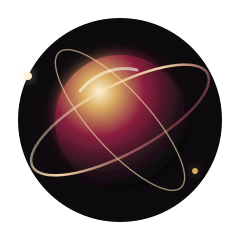

 

---

  Minimal. Refined. Impactful.

## ✨ Featured

<table>
<tr>
<td width="33%" align="center">

### 🛍️ HANOT+

`React Native` `Expo` `TypeScript`

</td>
<td width="33%" align="center">

### 🖥️ Atlas Hardware

`React` `Vite` `Tailwind`

</td>
<td width="33%" align="center">

### 📦 Stock Manager

`JavaScript` `HTML` `CSS`

</td>
</tr>
</table>

## ⚙️ Stack

  

