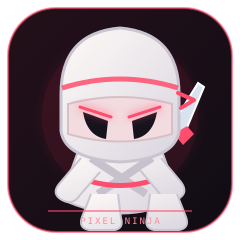

 

---

`🎮 PLAYER: SALOUA` &nbsp; `⚡ CLASS: FULL-STACK + MOBILE` &nbsp; `❤️ MODE: CREATE` 

## 🕹️ Select a project

<table>
<tr>
<td width="33%" align="center">

### 🛍️ HANOT+
Shopkeeper power-up

`React Native` `Expo` `TS`

</td>
<td width="33%" align="center">

### 🖥️ Atlas Hardware
Tech-shop level

`React` `Vite` `Tailwind`

</td>
<td width="33%" align="center">

### 📦 Gestion de Stock
Inventory quest

`JavaScript` `HTML` `CSS`

</td>
</tr>
</table>

## ⚔️ Loadout

  

